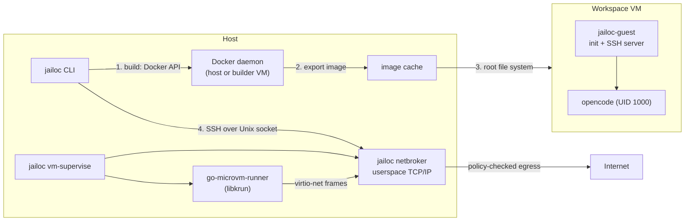

# Architecture

Each workspace runs in its own libkrun micro-VM. This page describes the processes on the host, what happens inside the guest, how files and the network reach the VM, and how images are built.

## Host processes

Every VM is owned by a detached supervisor process (`jailoc vm-supervise`). It starts the workspace's network broker, boots the VM through the go-microvm runner, waits until the guest is ready, and from then on keeps the two together: when either the VM or the broker exits, it stops the other. A workspace never runs without its broker.

The VM runtime (runner, libkrun and the libkrunfw guest kernel) is a separate download. jailoc pins its URL and SHA-256 per platform and fetches it on first use, so the jailoc binary itself stays free of C dependencies. `jailoc-guest` is pure Go and is embedded in jailoc, so it always matches the jailoc version. Upgrading jailoc takes effect in a workspace after `jailoc restart`.

## Images

Workspace images are ordinary Docker images: the embedded Dockerfile, a `[base] dockerfile` preset and an optional per-workspace overlay (`dockerfile`, `build_context`). See [Image Resolution](../reference/image-resolution.md). The image needs no entrypoint, command, exposed port or firewall setup, because `jailoc-guest` is the init.

`[vm] builder` decides where the build runs: the host Docker daemon, or a builder VM. The builder VM runs a pinned `docker:dind` image with a persistent data disk, reached through a Unix socket that its broker forwards into the VM. The finished image is exported and unpacked into a local image cache, and a builder VM shuts down afterwards.

Building on the host daemon is fastest, but Dockerfile `RUN` steps then run with container isolation and unrestricted host networking. A builder VM keeps build steps behind a VM boundary. All workspaces share one builder VM, with one build cache, and it reaches public addresses only. With `isolated_build`, a workspace gets a builder of its own, with a separate data disk and the workspace's `allowed_hosts` and `allowed_networks`, so one workspace's build steps can't read another workspace's build cache or private network access. Builds on the same builder are serialized.

## Inside the guest

The root file system is a copy-on-write clone of the unpacked image and is discarded on every start. `jailoc-guest` prepares the system and then serves SSH:

1. configures the network addresses, the broker as gateway and DNS resolver, and the hostname,
2. creates the `agent` user (UID 1000) when the image has none, and its home directory,
3. mounts the shares, binds the snapshots (including the Git configuration) and adds a forwarded CA bundle to the system trust store,
4. adds the hostname to `/etc/hosts`,
5. with `enable_docker`, formats the Docker data disk (20 GiB) on first use, mounts it at `/var/lib/docker` and starts `dockerd` with the socket owned by the `agent` group,
6. starts an SSH server that accepts only the workspace's key and runs every session as `agent`.

`jailoc-guest` leaves privileges alone by default, so the agent can use `sudo` from the image. Root in the VM is still inside the VM boundary.

### protect_git

With `protect_git`, `jailoc-guest` bind-mounts `.git/hooks` and `.git/config` of every repository in the shares read-only over themselves, turns the `.git` directories, the repositories and their parents into mount points that can't be renamed, and sets `no_new_privs` on all its threads. No session can then become root and undo the binds. Guest root could otherwise unmount them, which is why `protect_git` excludes `sudo` and `enable_docker` (Docker access is root access in the VM).

### Sessions

`jailoc` opens a session by connecting to the guest's SSH server through a Unix socket that the broker forwards into the VM. It authenticates with a per-workspace key and pins the guest's host key, which is generated for every start. The agent runs in a session held by `jailoc-guest`: a small process inside the VM owns the agent's terminal, so the agent keeps running when the SSH connection ends. When a terminal re-attaches, the holder replays the terminal modes the agent had switched on (alternate screen, mouse reporting, bracketed paste, keyboard protocols) and makes the agent redraw. Sessions live in VM memory and end when the VM stops. See [Manage sessions](../how-to/sessions.md).

`jailoc down` asks the guest to stop over a control share, so open files are flushed before the VM powers off.

## Files

### Shares

Workspace `paths`, the directories in `mounts`, the workspace configuration directory, the workspace cache directory and the persistent home directories reach the VM through virtio-fs. Read-only shares are enforced by the VMM: guest root can't remount them writable. virtio-fs shares directories only, so a `mounts` entry that points at a single file isn't supported; use `snapshots` for files.

Shares use simplified ownership: every guest process sees shared files as its own, and files it creates are owned by the host user. Permission bits stay meaningful on the host, and ownership changes inside the guest have no effect on host files.

### Snapshots

Files and directories in `snapshots`, and the Git configuration, aren't shared. jailoc copies them into the VM state directory when the VM starts and on every `jailoc reload`, shares that directory read-only, and the guest binds each item read-only at its destination. Each reload copies into a new directory and the guest replaces its binds; processes that opened a file earlier keep reading the old copy. Nothing the workspace does reaches the host original.

### Persistent home

Only `~/.local/share/opencode`, `~/.local/state/opencode` and `~/.cache` of the agent survive a restart. They live in `~/.cache/jailoc-vm/workspaces/<workspace>/home` on the host, next to the Docker data disk of `enable_docker`. `jailoc down --purge` deletes them.

### Secrets

Secrets never touch the root file system or a share. jailoc reads them on the host, sends them over SSH after the VM starts, and `jailoc-guest` writes file secrets to `/run/secrets`, an in-memory file system readable only by `agent`, and env secrets to the in-memory session environment. See [Secrets](secrets.md).

## Network

The VM has exactly one network interface, and its only peer is the workspace's broker on the host. The broker runs a userspace TCP/IP stack (gVisor), serves DHCP and DNS on the gateway, and checks every outgoing TCP connection and UDP flow against the workspace policy before it opens a host socket. See [Network Isolation](network-isolation.md).

The broker also carries a few host services: the SSH and Docker sockets for jailoc, the host SSH agent when `ssh_auth_sock` is on (exposed in the guest as `/run/ssh-agent.sock`, keys never enter the VM), and `ports`, which publish guest ports on host `127.0.0.1`.

## Trade-offs

- **Start time:** the first start builds and exports the image. Later starts reuse the cache; a builder VM has to boot before it can check the cache.
- **Resources:** `cpu` and `memory` size the whole VM, including its Docker daemon. Nothing limits processes inside it. A build in the builder VM adds the builder's own CPU and memory.
- **Docker inside the VM:** with `enable_docker`, containers share the VM's CPU, memory and network rules.
- **Platform:** darwin/arm64 and linux/amd64 (with access to `/dev/kvm`). Other platforms need a self-built go-microvm runtime set through `[vm] runner` and `[vm] lib_dir`.
