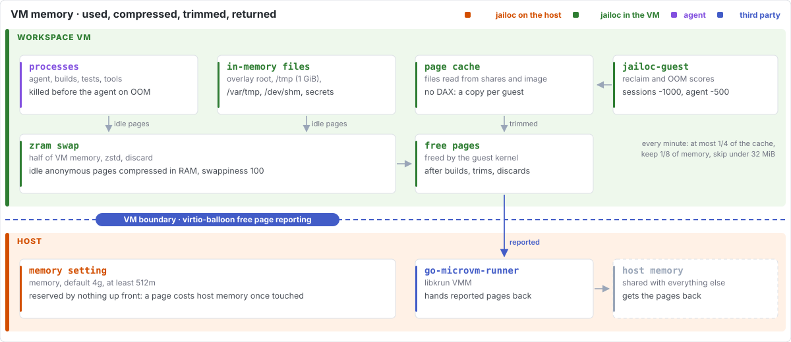

# Resource Use

A workspace is a whole VM, so it costs more than a container: its own kernel, its own page cache, and a fixed memory size. jailoc tries to keep that cost close to what the workspace actually uses. This page explains where memory, disk and host processes go, and which mechanisms keep them in check.

## Memory

`memory` sets the size of the VM's RAM (default `4g`, at least `512m`), and `cpu` the number of vCPUs, rounded up to whole CPUs. The host doesn't reserve that memory when the VM starts. Guest pages take host memory only once the guest touches them, so an idle workspace with `memory = "8g"` costs far less than 8 GiB. The work goes into keeping touched-but-unused pages from piling up.

### Returning free pages to the host

Without help, a VM's memory use on the host only grows: pages the guest frees stay allocated to the VM process. jailoc's VMs have a virtio-balloon device with free page reporting. The guest kernel reports pages it has freed, and the VMM hands them back to the host. Memory released inside the VM, for example when a build finishes, is returned to the host instead of staying attached to the VM until it stops.

### Trimming the file cache

Free page reporting only helps with pages the guest frees, and the Linux kernel doesn't free page cache on its own while it has room. Shares use virtio-fs without a DAX window, so every file the guest reads from a share, from the image or from the persistent home is copied into the guest's own page cache, next to the host's copy of the same file. After a large checkout, `npm install` or build, that cache can occupy most of the VM's memory and, through it, host memory.

`jailoc-guest` trims it once a minute. It reads the file cache size from `/proc/meminfo` and asks the kernel to reclaim part of it through the root cgroup's `memory.reclaim`, with swapping disabled for that request, so only file pages are dropped and nothing is pushed to swap. Each round reclaims at most a quarter of the cache, keeps at least one eighth of the VM memory as cache, and skips rounds that would free less than 32 MiB. Working files stay cached; data nobody reads any more is dropped gradually and returned to the host. Kernels without `memory.reclaim` fall back to dropping clean caches.

### Compressed swap

A VM has no swap disk. `jailoc-guest` sets up a zram device of half the VM memory as swap, compressed with zstd (lzo-rle on kernels without it). Anonymous pages that sit idle, such as a language server's index or a dormant dev server, are compressed in RAM instead of forcing the OOM killer to act. Swap is mounted with discard, so pages that come back from swap free their compressed slot right away. The guest swaps eagerly (`vm.swappiness = 100`) and reads single pages back (`vm.page-cluster = 0`), the usual settings for in-memory swap, where swapping is cheap and readahead buys nothing.

### What counts against memory

Besides process memory and page cache, a few file systems live in VM memory:

- The overlay over the read-only image: any file written outside the shares and the persistent home, for example a package installed with `apt-get`, stays in memory until the VM stops.
- `/tmp`, limited to 1 GiB, plus `/var/tmp` and `/dev/shm`.
- `/run/secrets` and the session environment.

These pages are anonymous memory, so idle ones go to compressed swap like any other.

### When memory runs out

When the VM still runs out of memory, the kernel's OOM killer picks a victim. `jailoc-guest` adjusts the scores so that the processes the agent started (tests, builds, containers) are killed before the agent, and session holders never, so a session survives and can be reattached. See [Architecture](architecture.md#memory-pressure).

## Disk

### Image cache

`jailoc` exports a built image from Docker and converts each layer it doesn't have yet into one read-only EROFS image file, `~/.cache/jailoc-vm/images/erofs/layers/<DiffID>.erofs`. No directory tree is extracted. A workspace image is a directory, `erofs/images/<image ID>/`, that holds hard links to its layer files and an `image.json`. The VM mounts the layer files read-only. The cache is content-addressed:

- An image that is already in the cache isn't exported again, so a restart with an unchanged image skips the export entirely.
- Layers already in the cache are skipped while the export streams, so a rebuild that changes only the top layer converts only that layer.
- Layers that several images share are stored once, through hard links, and workspaces that use the same image share one directory.

Since the VM mounts the cached layer files, starting a VM doesn't copy the image either; the only per-VM root file system is a small boot root with `jailoc-guest` and its configuration.

After every import, jailoc prunes the cache: workspace image directories that no workspace uses any more and that are older than one hour, and layer files that no remaining image links to. go-microvm's directory cache, which holds the builder VM image and workspace images unpacked by older jailoc releases, is pruned as well: unpacked trees nothing references, and layers unused for two weeks. Running VMs from older releases keep using their unpacked image until they restart.

### Data disks

The builder VM and workspaces with `enable_docker` have a data disk, 20 GiB unless `docker_disk` sets another size. Disks are sparse files, so they take host space only for blocks that have been written, but blocks freed inside the VM stay allocated on the host. Raising `docker_disk` grows the disk on the next start; it never shrinks. Workspaces without `enable_docker` get no disk at all and don't start a Docker daemon.

### VM runtime

Release builds embed the VMM runtime and kernel firmware. They are unpacked into the cache once, into a directory named after their checksum, and shared by every workspace and by later runs of the same jailoc build. Unpacked runtimes and guest binaries that no workspace or builder VM references and that have not been used for seven days are removed on `jailoc up`.

## Builds

By default (`builder = "auto"`), images are built with the host Docker daemon when one is available for the right architecture, which costs no extra VM. Otherwise a builder VM with 4 vCPUs and 4 GiB of memory boots for the build and stops when it finishes, so it uses memory only while building. Builds on one builder run one at a time, and the shared builder keeps one build cache for all workspaces; `isolated_build` trades that sharing for separation. See [Architecture](architecture.md#images).

## Restarts and reloads

A restart costs a VM boot and, after an image change, an export. Much of the configuration doesn't need one: `jailoc reload` applies network rules, DNS filtering, `ports`, `host_ports`, `ssh_auth_sock`, `gpg_agent`, `ca_bundle`, `snapshots`, `env`, `env_file` and secrets to the running VM. Changes to `cpu`, `memory`, `docker_disk`, `paths`, `mounts`, `enable_docker`, `protect_git` and the image need a restart.

## Host processes

Each running workspace has three host processes: a supervisor, the VMM and the network broker. The broker runs a userspace TCP/IP stack and opens a host socket for every guest connection it allows. To keep one workspace from exhausting host sockets or memory, it holds at most 4096 TCP connections (including host services) and 1024 UDP flows at once, idle UDP flows close after a minute, and filtered DNS handles at most 128 queries and 64 TCP connections at once. Connections and flows over a limit are refused; refused ones appear in `jailoc traffic`, while DNS queries over the limit are dropped and the client retries.

## Logs

Logs that grow with VM activity are rotated, keeping one previous file:

| Log | Rotated at |
|-----|------------|
| Broker traffic log (`broker.jsonl`) | 16 MiB |
| Guest process log (`jailoc strace`) | 16 MiB |
| jailoc's own log | 5 MiB |

The VM console log is kept for the life of the VM and isn't rotated. See [Troubleshooting](../how-to/troubleshooting.md) for where each file lives.
