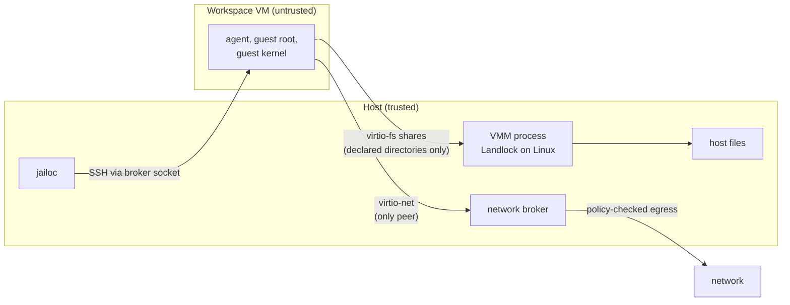

# Security Boundaries

jailoc treats everything inside a workspace VM as hostile: the coding agent, every process it starts, guest root and the guest kernel. This page lists what jailoc trusts, the boundaries it enforces between trusted and untrusted parts, every channel that crosses them, and what lies outside the protection. [Threat Model](threat-model.md) explains why the boundaries are drawn this way.

## Trust levels

| Party | Trust | Why |
|-------|-------|-----|
| The host user running `jailoc` | Trusted | Owns the configuration, the shares and every host process jailoc starts |
| `config.toml`, `env_file`s and the files it references | Trusted | Decides what the VM may reach; `from_command` secrets and `[vm] runner` run as the host user |
| jailoc, `jailoc-guest` and the embedded VM runtime | Trusted | Release builds are attested; `jailoc-guest` is embedded in jailoc and always matches its version |
| Workspace images and Dockerfiles, including URL presets | Trusted to build, untrusted at run time | Build steps run with the builder's privileges; at run time the image is part of the guest |
| Everything inside a workspace VM | Untrusted | The agent processes untrusted content and can become root in the guest |
| Network destinations, DNS answers | Untrusted | DNS answers never open the network policy on their own |

## The boundaries

### VM and host

The hypervisor (KVM on Linux, Hypervisor.framework on macOS) separates the guest kernel from the host kernel. Guest root controls the guest and nothing else; everything it can reach on the host goes through devices the VMM provides:

- virtio-fs shares for workspace `paths`, `mounts` and jailoc's internal shares. Read-only shares are enforced by the VMM, so guest root can't remount them writable.
- One virtio-net interface whose only peer is the workspace's network broker.
- Unix sockets on the host that the broker forwards: the guest SSH server for jailoc, the host SSH agent with `ssh_auth_sock`, and `host_ports` targets.

libkrun's virtio-fs server doesn't confine file requests to the shared directories by itself. On Linux, jailoc runs the VMM process under Landlock with access only to the VM runtime, `/dev/kvm` and the null and random devices, the VM's root filesystem, data directory and disks, the unpacked image (read-only) and the declared shares, and refuses to start a VM when the kernel lacks Landlock. Landlock doesn't cover metadata operations such as `stat`, `chmod` or extended attributes. On macOS the VMM process runs without equivalent confinement.

The host trusts nothing it reads back from the guest. The read-write internal share is writable by the guest, so it never holds keys or the VM specification, and jailoc accesses it only in ways that can't follow a link out of it. Per-workspace state directories on the host are created with mode `0700`.

### Guest and network

The network broker runs on the host, so nothing in the guest can change its policy. It terminates every guest connection in a userspace TCP/IP stack and opens a host socket only for destinations the policy allows: public addresses are allowed, private and reserved ranges are denied unless `allowed_networks` or a resolved `allowed_hosts` address opens them, and loopback, multicast, cloud metadata endpoints and special IPv6 ranges stay denied regardless. The guest has no network when the broker isn't running, and the VM stops when the broker exits. Containers from the in-VM Docker daemon go through the same broker. See [Network Isolation](network-isolation.md).

### Workspace and workspace

Each workspace has its own VM, broker, SSH key, state directory and persistent home. A workspace doesn't see another workspace's files, secrets, sessions or network allowances, except through state the configuration shares between them:

| Shared state | Effect |
|--------------|--------|
| A `paths` or `mounts` directory used by several workspaces | Every workspace with the share can read and change it |
| A named agent profile | Logins, hooks, plugins and MCP settings carry across workspaces |
| A read-write agent configuration mount, such as OpenCode's default `~/.config/opencode` | The agent can plant configuration that runs in every workspace using the mount, and on the host |
| The shared builder VM | One build cache for every workspace that builds there; use `isolated_build` to separate it |

Workspaces that share a profile, a writable configuration mount or a directory share one trust level.

### Agent and guest root

Inside the VM the agent runs as `agent` (UID 1000) and can use `sudo` from the image. Guest root is not a boundary jailoc relies on, with one exception: `protect_git` sets `no_new_privs` in `jailoc-guest`, which every session inherits, binds `.git/hooks`, `.git/config` and the Git files they point to of repositories in the read-write `paths` and `mounts` read-only, and rejects `enable_docker`, because Docker access is root access in the VM. Without `protect_git`, the agent can rewrite Git hooks and configuration in shared repositories, and they run on the host the next time you use Git there.

### Image builds and host

Dockerfile `RUN` steps run where the image is built:

| Builder | Isolation of build steps |
|---------|--------------------------|
| Host Docker daemon (`builder = "docker"`, or `"auto"` with a usable daemon) | Container isolation only, with the host's full network access |
| Shared builder VM (`builder = "vm"`) | VM boundary, public addresses only, one cache for all workspaces |
| Per-workspace builder VM (`isolated_build`) | VM boundary, the workspace's network policy, its own cache |

Build a Dockerfile you don't trust only in a builder VM.

## Channels across the boundaries

Every way data or control crosses from the host into a workspace is opt-in or fixed by jailoc:

| Channel | Direction | What the guest can do with it | Configured by |
|---------|-----------|-------------------------------|---------------|
| Workspace `paths`, `rw` mounts | Both | Read, change and delete the files on the host | `paths`, `mounts` |
| `ro` mounts | Host to guest | Read the files | `mounts` |
| Snapshots, Git configuration, `known_hosts` | Host to guest | Read a copy; nothing writes back | `snapshots`, `git_config`, `ssh_auth_sock` |
| Secrets | Host to guest | Read every configured value | `secrets` |
| SSH agent | Guest to host | Ask the host agent to sign while forwarded; keys stay on the host | `ssh_auth_sock` |
| `host_ports` | Guest to host | Use the host service like a local host process, outside the network policy | `host_ports` |
| `ports` | Host to guest | Serve on host `127.0.0.1` | `ports` |
| CA bundle | Host to guest | Trust the forwarded certificates | `ca_bundle` |
| Network egress | Guest to network | Reach public addresses and allowed private ones | `allowed_hosts`, `allowed_networks`, `filtered_dns` |
| SSH session | Host to guest | Accept sessions only from jailoc, which authenticates with a per-workspace key and pins the guest host key generated at each start | fixed |

`host_ports` deserves the most care. A Chrome DevTools port or a container runtime socket gives the guest control of the browser or the host; jailoc warns about both.

## Outside the boundaries

jailoc doesn't protect against:

- **Exfiltration to the public internet.** Public egress is open, so anything the agent can read (shared source, secrets, snapshots) can leave the machine.
- **The agent reading what it's given.** Shared directories, snapshots and every configured secret are visible to the agent and to guest root.
- **Changes to shared directories.** Writes land on the host immediately; `protect_git` covers Git hooks and configuration only.
- **Services reached through `host_ports` or the SSH agent.** Their own access control is the only limit.
- **Bugs in the hypervisor, libkrun, the VMM process or the broker.** These run on the host as your user.
- **virtio-fs confinement on macOS**, and metadata operations on host files outside the shares on Linux, for a guest kernel under the agent's control.
- **Prompt injection itself.** jailoc limits what a manipulated agent can reach, not whether it gets manipulated.
- **Resource exhaustion inside the VM.** `cpu` and `memory` cap the whole VM; nothing limits processes inside it.

## Release integrity

Release assets carry GitHub build provenance attestations and SPDX SBOMs, and every archive lists bundled components in `THIRD_PARTY_NOTICES`. Docker CE in the Docker layer is pinned and checksum-verified, and the builder VM image is pinned. See [Installation](../how-to/installation.md#check-the-runtime-licenses) for verifying a download.

## Reporting a vulnerability

Report vulnerabilities privately through [GitHub security advisories](https://github.com/seznam/jailoc/security/advisories/new), not in public issues. [SECURITY.md](https://github.com/seznam/jailoc/blob/main/SECURITY.md) describes what is in scope.
