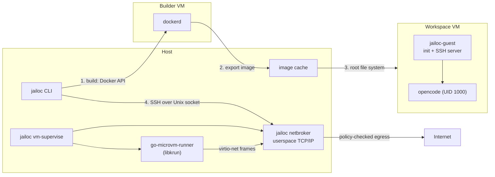

# VM Backend

The default backend runs each workspace as containers on the host Docker daemon. Their isolation is the Linux kernel's namespace and cgroup isolation, plus an iptables firewall inside the agent container. `backend = "vm"` moves the agent into its own virtual machine, so a kernel exploit, a privilege escalation or a malicious build step ends inside a disposable VM instead of on the host or its Docker daemon.

## Architecture

`jailoc up` runs in two phases:

1. **Build.** A builder VM boots a pinned `docker:dind` image with a persistent data disk. jailoc runs its regular image resolution against the builder's Docker daemon through a Unix socket that the network broker forwards into the VM, so workspace images, Dockerfile overlays and their build cache behave as with the Docker backend. The finished image is exported and unpacked into a local image cache, and the builder shuts down.
2. **Run.** The workspace VM boots the unpacked image as its root file system, with `jailoc-guest` as its init process. jailoc then delivers secrets over SSH.

Every VM is owned by a detached supervisor process that starts its network broker, boots the VM, waits until the VM is ready, and from then on keeps the two together: when either the VM or the broker exits, it stops the other.

The VM runtime (the runner process, libkrun and the libkrunfw guest kernel) is a separate download: jailoc pins its URL and SHA-256 per platform and fetches it on first use, so the jailoc binary stays free of C dependencies for users of the Docker backend. `jailoc-guest` is pure Go and is embedded in jailoc itself, so it always matches the jailoc version.

## Builder

All VM workspaces share one builder by default. It keeps one build cache for all of them and reaches public addresses only. With `isolated_build`, a workspace gets a builder of its own, with a separate data disk and the workspace's `allowed_hosts` and `allowed_networks`, so build steps of one workspace cannot read another workspace's build cache or private network access. Builds of the same builder are serialized.

## Workspace VM

The root file system is a copy-on-write clone of the unpacked image and is discarded on every start; only `~/.local/share/opencode` and `~/.cache` of the agent persist, in the workspace's VM state directory. `jailoc-guest` prepares the system and then serves SSH:

1. mounts the shared directories,
2. configures the network address, the broker as gateway and DNS resolver, and the hostname,
3. creates the `agent` user (UID 1000) when the image has none, copies the Git configuration and adds a forwarded CA bundle to the system trust store,
4. drops the capabilities that allow changing users or binding privileged ports and sets `no_new_privs`, so nothing started through SSH can gain privileges,
5. starts an SSH server that accepts only the workspace's key and runs every session as `agent`.

`jailoc` opens a session by connecting to the SSH server through a Unix socket that the broker forwards into the VM. It authenticates with a per-workspace key and pins the guest's host key, which is generated anew for every start. The session gets a terminal of its own; window size changes are forwarded. `jailoc down` asks the guest to stop over a control share, so open files are flushed before the VM powers off.

Secrets never touch the root file system or a share: jailoc sends them over SSH after the VM starts, and `jailoc-guest` writes them to `/run/secrets` (in memory, readable only by `agent`).

## Filesystem sharing

Workspace `paths`, the host directories of `mounts`, the workspace configuration directory, the workspace cache directory and the persistent home directories are shared into the VM with virtio-fs. Read-only shares are enforced by the VMM: guest root cannot remount them writable. Sharing works on directories only, which is why file mounts and the SSH agent socket are not available.

Shares use simplified ownership semantics: every guest process sees shared files as its own, and files it creates are owned by the host user. Permission bits stay meaningful on the host; ownership changes inside the guest have no effect on host files.

## Network

Each VM has exactly one network interface, and its only peer is its jailoc network broker on the host. The broker runs a userspace TCP/IP stack, serves DHCP and DNS, and decides every outgoing TCP connection and UDP flow before it opens a host socket:

| Destination | Decision |
|-------------|----------|
| Public IPv4 addresses | allowed |
| Addresses of any host interface, the broker gateway, the guest's own subnet | blocked |
| Loopback, link-local, multicast, reserved, cloud metadata endpoints | blocked |
| Private ranges (RFC 1918, CGNAT and other special-purpose ranges) | blocked unless covered by `allowed_networks` or a resolved `allowed_hosts` address |
| IPv6 | blocked |

Denied TCP connections are reset; denied UDP is dropped. DNS answers never change a decision: a public name that resolves to a private address is still blocked. Each decision is written to `broker.jsonl`.

No port is published on the host. An invalid policy file at start prevents the VM from starting. If the broker exits, the supervisor stops the VM, so the workspace never runs without its broker.

## Trade-offs

- **Start time:** a cached start takes about 15 seconds on Apple Silicon, most of it checking the image in the builder; the first start builds the image.
- **Resources:** each workspace reserves its own VM memory (`memory` + 1 GiB) and vCPUs (`cpu` rounded up); a running build adds the builder (4 vCPUs, 4 GiB).
- **No Docker for the agent:** the workspace VM has no Docker daemon.
- **No remote mode:** sessions run OpenCode inside the VM; there is no OpenCode server port on the host.
- **Platform:** tested on macOS with libkrun. The broker is IPv4 only.

See the [threat model](threat-model.md) for what jailoc protects against in general, and [Run a workspace in a VM](../how-to/vm-backend.md) for setup.
