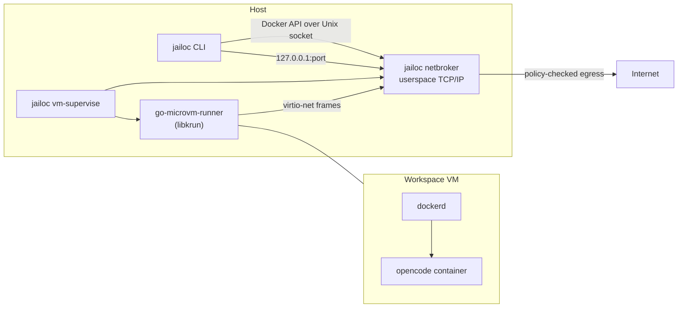

# VM Backend

The default backend runs each workspace as containers on the host Docker daemon. Their isolation is the Linux kernel's namespace and cgroup isolation, plus an iptables firewall inside the agent container. `backend = "vm"` moves the whole workspace into its own virtual machine, so a container escape, a privileged container or a malicious build step ends inside a disposable VM instead of on the host or its Docker daemon.

## Architecture

`jailoc up` starts a detached supervisor process per workspace. The supervisor starts the network broker, boots the VM, waits until the guest Docker daemon answers, and from then on keeps the two together: when either the VM or the broker exits, it stops the other. `jailoc down` asks the guest to stop its Docker daemon cleanly before the VM powers off, so the data disk stays consistent.

The VM runtime (the runner process, libkrun and the libkrunfw guest kernel) is a separate download: jailoc pins its URL and SHA-256 per platform and fetches it on first use, so the jailoc binary stays small and free of C dependencies for users of the Docker backend.

The rest of jailoc is unchanged. Image resolution, overlay builds, `docker compose up`, `logs`, `exec` and `attach` all use the regular Docker client code, pointed at the guest Docker daemon through a Unix socket that the broker forwards into the VM. Builds and image pulls happen inside the VM; nothing touches a host Docker daemon.

## Guest

The VM boots a pinned `docker:dind` image (Alpine Linux) with a small jailoc init script instead of its normal entrypoint. The init script:

1. mounts the shared directories at their host paths,
2. requests an address from the broker's DHCP server,
3. formats the data disk on first use and mounts it at `/var/lib/docker`,
4. starts `dockerd` with its nftables firewall backend, listening on its Unix socket and on the guest address for the broker's API forward, with a guest firewall rule that accepts the API port only from the broker gateway,
5. waits for a shutdown request from the supervisor.

The guest root file system is a copy-on-write clone of the cached image and is discarded on every start. Only the data disk (`docker.img`, 20 GiB sparse) persists, which keeps images, volumes and build cache between starts.

## Filesystem sharing

Workspace `paths`, the host directories of `mounts`, the workspace configuration directory and the workspace cache directory are shared into the VM with virtio-fs at their host paths. Read-only shares are enforced by the VMM: guest root cannot remount them writable. Sharing works on directories only, which is why file mounts and the SSH agent socket are not available.

Shares use simplified ownership semantics: every guest process sees shared files as its own, and files it creates are owned by the host user. Permission bits stay meaningful on the host; ownership changes inside the guest have no effect on host files.

## Network

The VM has exactly one network interface, and its only peer is the jailoc network broker on the host. The broker runs a userspace TCP/IP stack, serves DHCP and DNS, and decides every outgoing TCP connection and UDP flow before it opens a host socket:

| Destination | Decision |
|-------------|----------|
| Public IPv4 addresses | allowed |
| Addresses of any host interface, the broker gateway, the guest's own subnet | blocked |
| Loopback, link-local, multicast, reserved, cloud metadata endpoints | blocked |
| Private ranges (RFC 1918, CGNAT and other special-purpose ranges) | blocked unless covered by `allowed_networks` or a resolved `allowed_hosts` address |
| IPv6 | blocked |

Denied TCP connections are reset; denied UDP is dropped. DNS answers never change a decision: a public name that resolves to a private address is still blocked. Each decision is written to `broker.jsonl`.

The OpenCode port is published only on host `127.0.0.1`; the broker forwards it into the VM. An invalid policy file at start prevents the VM from starting. If the broker exits, the supervisor stops the VM, so the workspace never runs without its broker.

Because the broker enforces policy outside the VM, the agent container does not set up its own iptables firewall in VM mode. The policy holds even for privileged containers and host-network containers inside the VM.

## Trade-offs

- **Start time:** a cached start takes a few seconds; the first start pulls and builds images inside the VM.
- **Resources:** each workspace reserves its own VM memory (`memory` + 1 GiB) and vCPUs (`cpu` rounded up, plus one).
- **Nested Docker:** the guest kernel lacks the iptables extensions that a nested `docker:dind` needs. Containers started by the agent work; Docker-in-Docker inside them does not.
- **Platform:** tested on macOS with libkrun. The broker is IPv4 only.

See the [threat model](threat-model.md) for what jailoc protects against in general, and [Run a workspace in a VM](../how-to/vm-backend.md) for setup.
