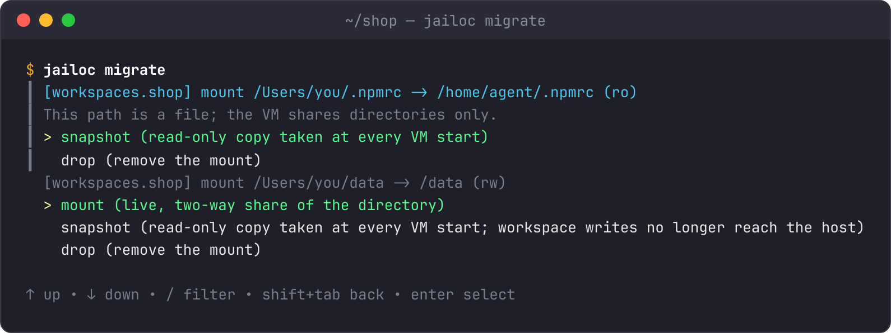

# How to migrate from jailoc v1

jailoc v2 runs every workspace in its own micro-VM. The Docker Compose backend of v1, remote mode and the published OpenCode port are gone. This guide moves an existing v1 configuration and its OpenCode data to v2. The same command also converts deprecated network settings in any configuration (see [Convert deprecated network settings](#convert-deprecated-network-settings)).

## Recognize a v1 configuration

jailoc v2 refuses to load a config that contains v1 settings and names the setting:

```text
mode is a jailoc v1 setting; run `jailoc migrate` to update the config
```

These settings trigger it:

| Setting | Where | Why it's rejected |
|---------|-------|-------------------|
| `backend = "docker"` | `[defaults]` or a workspace | Workspaces run only as VMs. Omit `backend` or set `"vm"`. Any `backend` value other than `"vm"` or empty is rejected. |
| `mode` | top level only | Sessions always run over SSH into the VM; there's no remote or exec mode. |
| `password_mode` | top level only | No OpenCode server port is published, so there's no server password. |
| `expose_port` | `[defaults]` or a workspace | Same reason. Use `ports` to publish services from the VM. |

In v1 an unset `backend` meant Docker, so `jailoc migrate` treats a workspace whose effective `backend` isn't `"vm"` as a Docker workspace. One configuration is asked about instead: no `backend` in `[defaults]`, none of the settings above, and only deprecated network settings. `jailoc migrate` then asks whether it is a v1 (Docker) configuration whose workspaces should move to the VM backend; the default answer is no, which skips the Docker steps (mounts, stopping workspaces, data copy).

## Check the prerequisites

- A supported host: macOS on Apple Silicon, or Linux on amd64 (arm64 experimental) with read and write access to `/dev/kvm`. See [Installation](installation.md).
- Docker Engine running on the host, to check for running v1 workspaces and copy their Docker data volumes. Without a reachable daemon, `jailoc migrate` skips these steps after confirmation (see [Docker data is not copied](#docker-data-is-not-copied)).

## Preview the migration

Run the dry run first. It prints the planned changes and the resulting config without touching anything:

```bash
jailoc migrate --dry-run
```

`jailoc migrate` asks questions, so without a terminal on standard input it needs `-y`, `--dry-run` included.

## Run the migration

```bash
jailoc migrate
```

For each Docker workspace, jailoc:

1. Asks how to carry over every entry in `mounts`. The `[defaults]` mounts are asked about once, and only when a Docker workspace is migrated:
    - `mount`: keep it as a live directory share (offered for directories only; the default for a directory).
    - `snapshot`: turn it into a read-only entry in `snapshots` (the default for a file). Single-file mounts must become snapshots, because the VM shares directories only.
    - `drop`: remove it.

    

2. Lists the v1 settings from the table above per scope and asks to confirm removing them. Declining stops the migration.
3. Asks to stop the running Docker workspaces, then stops them.
4. Copies the Docker volumes `opencode-data-<workspace>` and `opencode-cache-<workspace>` into the VM's home directory data. The first start copies the OpenCode data (sessions and logins) to `state.img`; the cache copy stays in `legacy-home`, because `cache.img` starts empty (see [Persistent state](../reference/configuration.md#persistent-state)).
5. Sets `backend = "vm"` in `[defaults]` and removes every workspace-level `backend`.

The copy in step 4:

- is skipped when a mount covers those paths or VM data already exists there;
- leaves the Docker volumes in place;
- keeps symbolic links, but skips device nodes, FIFOs and additional hard-link names of a file; of hard-linked names, only one keeps its content.

The default agent is OpenCode 2, which keeps its sessions separately; set `agent = "opencode1"` to keep working with the copied ones (see [Choose a coding agent](coding-agents.md#select-the-agent)).

The previous config is kept as `config.toml.pre-vm-migration` next to `config.toml` (a timestamp is appended if that file already exists). Comments in the old file aren't carried over. Settings jailoc doesn't know are listed and removed too.

To accept the default answer to every question, for example in a script:

```bash
jailoc migrate -y
```

## Convert deprecated network settings

This part of `jailoc migrate` applies to any configuration that uses the older network fields, not only to v1 ones. In `[defaults]` and in every workspace it:

- moves `allowed_hosts`, `allowed_networks`, `dns_upstream` and `dns_blocked_zones` into `network.dns` and `[[*.network.rules]]`;
- removes `filtered_dns`;
- adds a rule with `allow = ["*"]` when the configuration had no `network.rules`;
- adds `agent_endpoints` to `[defaults.network]` (when the default agent is OpenCode or OmO) and to OpenCode or OmO workspaces that need other endpoints, when no scope sets `agent_endpoints`. It asks which model providers you use (all selected by default; `--yes` takes all) and writes their endpoints. Without it these agents can't reach their providers; Claude Code, Copilot CLI and Antigravity keep their built-in endpoints. See [`rule=agent`](../reference/configuration.md#ruleagent);
- keeps the value of the new field and removes the old one when both are set.

After converting deprecated settings, `jailoc migrate` asks for optional `internal_zones` when no non-empty `internal_zones` exists in `[defaults]` or any workspace and explicit `allow` rules include hostnames. Wildcard hostnames count; `*`, IP addresses, CIDRs and `deny` rules do not. Answer with comma- or whitespace-separated DNS zones; they are stored in `defaults.network.internal_zones` and apply to every workspace. A blank answer leaves the zones unset; `--yes` skips the question. `--dry-run` asks the question and previews the result without writing it. Zones added by the conversion of legacy `allowed_hosts` suppress the question. The question also applies to configurations without deprecated settings.

Only list zones whose DNS you control. A zone and its subdomains may resolve to private addresses; for names outside the zones, the broker filters private answers to prevent DNS rebinding. A zone grants no access alone: a matching egress `allow` rule is still required. See [Internal zones](../reference/configuration.md#internal-zones).

See [Moved network settings](../reference/configuration.md#moved-network-settings) for the config load error these fields trigger.

## Start the migrated workspace

```bash
jailoc up my-project
jailoc
```

The first start builds the image and boots the VM; later starts reuse the build cache and take a few seconds.

## Adjust your habits

| v1 | v2 |
|----|----|
| `jailoc attach` | `jailoc` or `jailoc --attach <ID>`. See [Sessions](sessions.md). |
| `jailoc --remote`, `jailoc --exec`, `--dir` | `jailoc [path]` opens the session in that directory. |
| `opencode attach` from the host to the published port | Not available. Use `jailoc` sessions; publish other services with `ports`. |
| Single-file `mounts` | `snapshots`. See [Workspace configuration](workspace-configuration.md). |
| `git_config` live mount | Read-only snapshot taken at VM start. See [SSH and Git passthrough](ssh-git-passthrough.md). |
| Secret files bind-mounted from the host | Pushed over SSH to `/run/secrets`. See [Secrets](secrets.md). |

After migrating, building workspace images has its own requirements; see [Custom images](custom-images.md#choose-where-images-are-built) and the [`builder` field](../reference/configuration.md).

## Troubleshoot a migration

### Config still fails to load

**Symptom:** a command fails with a `... is a jailoc v1 setting` error (see [Recognize a v1 configuration](#recognize-a-v1-configuration)).

**Fix:** preview and run the migration, which rewrites these settings and carries over v1 Docker workspaces:

```bash
jailoc migrate --dry-run   # preview
jailoc migrate
```

### migrate asks for a terminal

**Symptom:** `jailoc migrate` fails with `migrate asks questions; run it in a terminal or pass --yes to accept the defaults`.

**Fix:** run it in a terminal, or pass `-y` to accept the default answer to every question. `--dry-run` needs the same.

### The migration stops after a question

**Symptom:** `jailoc migrate` stops with one of:

- `<scope>: the VM backend needs these settings removed; edit config.toml or answer yes`: you declined removing the v1 settings;
- `stop the running workspaces first (jailoc down), then run migrate again`: you declined stopping the running Docker workspaces;
- `migration cancelled`: you declined to continue without Docker.

**Fix:** accept the migration's confirmation to remove the incompatible settings and stop the Docker workspaces, or edit the rejected settings before retrying. If Docker is unavailable, see [Docker data is not copied](#docker-data-is-not-copied).

### Docker data is not copied

**Symptom:** `jailoc migrate` prints `Docker is not reachable`, or the copy prints `<workspace>: <path> already has VM data; keeping it`.

**Cause:** without a reachable Docker daemon, running workspaces aren't checked and the OpenCode data in Docker volumes isn't copied. The question `Continue without Docker?` defaults to yes, so `-y` continues. The copy skips any destination that already exists, on every run, and never overwrites it.

!!! warning
    Don't purge or delete existing VM data to make a retry copy. While the restored v1 config is in place, don't run `jailoc down`: it loads the config and fails validation on the v1 settings. Stop VMs before you restore it.

**Fix:** pick the case that matches.

1. **The `Continue without Docker?` question is still open.** Answer no. That cancels before the configuration is written. Start Docker and run `jailoc migrate` again.

2. **The migration already completed without Docker** (you answered yes, or passed `-y`). The converted config no longer selects the old Docker workspaces, so a plain `jailoc migrate` finds nothing to migrate and copies nothing. To copy the data:
    1. Stop each affected running VM with `jailoc down <workspace>` while the converted config is still in place. Don't pass `--purge`.
    2. Preserve the current `config.toml`, and any VM data the workspace already has, somewhere outside the jailoc directories. If a copy destination listed in case 3 already exists, follow case 3 instead; a retry doesn't replace it.
    3. Restore the pre-migration config named in the completion output (`Migrated config.toml (previous version: <path>)`). Copy that exact file back over `config.toml`; don't guess the name, because a timestamp is appended when an earlier backup exists.
    4. Start Docker, preview with `jailoc migrate --dry-run`, then run `jailoc migrate`.
    5. Re-apply deliberately any edits you made to the converted config after the first migration; the restored file doesn't contain them.

3. **The copy prints `already has VM data; keeping it`.** The destination exists, so the copy skips it without asking, on every retry. jailoc has no merge. The destinations are `~/.cache/jailoc-vm/workspaces/<workspace>/guest/home/opencode-data` and `.../guest/home/cache`. Stop the affected VM with `jailoc down <workspace>` before you copy or reconcile anything, and keep the current config, the VM data and the Docker volumes `opencode-data-<workspace>` and `opencode-cache-<workspace>`, which the migration leaves in place. Decide which data to keep and reconcile it by hand; don't delete or overwrite the existing data to force a retry.

If something else fails, see [Troubleshooting](troubleshooting.md).
