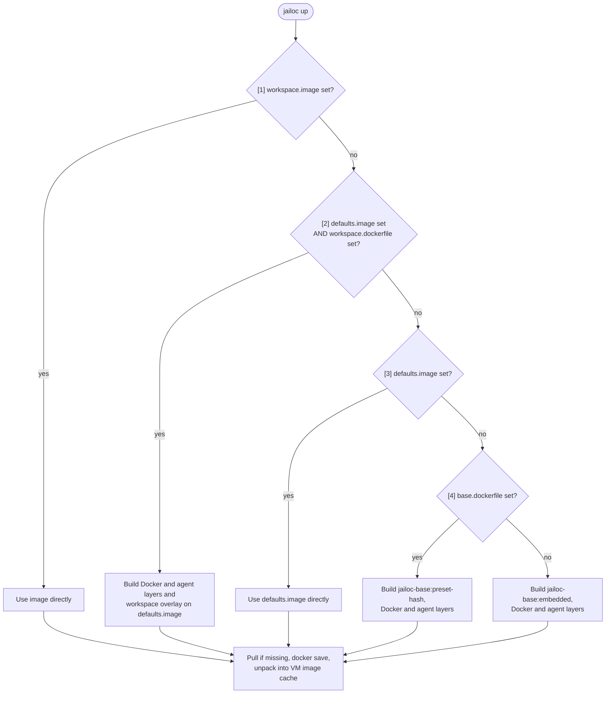

# Image Resolution Reference

During `jailoc up` and `jailoc restart`, jailoc resolves the workspace image with a Docker daemon, then unpacks it into the VM image cache as the root file system of the workspace VM.

---

## Build location

| `[vm] builder` | `isolated_build` | Docker daemon used |
|---|---|---|
| any | `true` | Builder VM of the workspace (`~/.cache/jailoc-vm/workspaces/<workspace>/builder`), with its own build cache and the workspace's network policy |
| `"auto"` or empty | `false` | Host daemon when it answers, is Docker Engine 25 or later, and runs Linux on the host's CPU architecture, otherwise the shared builder VM |
| `"docker"` | `false` | Host daemon; `jailoc up` fails when it is unusable |
| `"vm"` | `false` | Shared builder VM (`~/.cache/jailoc-vm/builder`) |

`jailoc down --purge` deletes the workspace's builder VM and its build cache.

---

## Resolution Cascade

The first step that applies wins; later steps are skipped.



### Step 1: Workspace image

**Trigger:** `image` is set in `[workspaces.<name>]`.

No build runs; `dockerfile` and `build_context` are not consulted (combining them with `image` is a validation error).

### Step 2: Defaults image with workspace overlay

**Trigger:** `[defaults] image` and workspace `dockerfile` are both set.

The [Docker layer](#docker-layer-steps-2-4-and-5) and the [agent layer](#agent-layer-steps-2-4-and-5) are built on top of `defaults.image`, then the workspace Dockerfile on top of that, passed as the `BASE` build argument. The Dockerfile must start with:

```dockerfile
ARG BASE
FROM ${BASE}
```

The result is tagged `jailoc-<workspace>:<content-hash>`. Build failure is fatal.

### Step 3: Defaults image

**Trigger:** `[defaults] image` is set and the workspace has no `dockerfile`.

No build runs.

### Step 4: Base Dockerfile

**Trigger:** `[base] dockerfile` is set and no workspace or default `image` is set.

The Dockerfile is loaded from a local path or HTTP(S) URL (maximum 1 MiB) and built as `jailoc-base:preset-<content-hash>`. Load or build failure is fatal; there is no fallback to the embedded image.

### Step 5: Embedded Dockerfile

**Trigger:** none of the above apply.

The Dockerfile embedded in the jailoc binary is built as `jailoc-base:embedded`. See [Default Image](default-image.md).

### Docker layer (steps 2, 4 and 5)

With `enable_docker` on, Docker CE, the buildx and compose plugins and `nftables` are added in a layer on top of the base image, tagged `jailoc-docker:<content-hash>`. The binaries are pinned and checksum-verified in the embedded `docker.Dockerfile` and copied to `/usr/local/bin` and `/usr/local/lib/docker/cli-plugins`. `nftables` is installed with `apt-get` unless `nft` is on `PATH`. With `enable_docker = false` or `protect_git = true`, the layer is skipped. Images used directly (steps 1 and 3) get no Docker layer and must contain `dockerd` for Docker in the VM.

### Agent layer (steps 2, 4 and 5)

The workspace's [coding agent](configuration.md#coding-agents) is installed with `npm install -g` of its pinned package in a layer on top of the Docker layer (or the base image when it is skipped), tagged `jailoc-agent-<agent>:<content-hash>`. The base image needs `npm` on `PATH`. The layer is skipped with `agents.<agent>.install = false`. Images used directly (steps 1 and 3) get no agent layer and must contain the agent binary.

### Workspace overlay (steps 4 and 5)

After step 4 or 5, a workspace `dockerfile` is built on top of the agent layer (or the base image when it is skipped) with `BASE` set to it, and tagged `jailoc-<workspace>:<content-hash>`.

---

## Build details

- `<content-hash>` is derived from the SHA-256 of the Dockerfile content: 8 hex characters for workspace overlays, 16 for `[base] dockerfile` presets. The Docker and agent layer hashes also cover the base image ID.
- Host proxy variables (`HTTP_PROXY`, `HTTPS_PROXY`, `NO_PROXY`, `FTP_PROXY`, `ALL_PROXY` and lowercase variants) are passed as build arguments to every build.
- Overlay build context: `build_context` when set; otherwise the Dockerfile's parent directory for a local path, or an empty temporary directory for a URL.
- Images from steps 1 and 3 are pulled for `linux/<host architecture>` when the daemon does not have them.

## Unpacking into the VM

jailoc exports the final image with `docker save` and unpacks it into `~/.cache/jailoc-vm/images` under `jailoc.local/rootfs:<image ID>`. An image ID already in the cache is not unpacked again, and layers already in the cache are skipped while the export streams in. Unpacked images that no workspace or builder uses are pruned. `docker save` must write an OCI image layout, which requires Docker Engine 25 or later; with an older host daemon, `"auto"` builds in the shared builder VM and `"docker"` fails.

jailoc labels the images it builds with `com.github.seznam.jailoc`. After unpacking, it removes labelled `jailoc-*` images from the Docker daemon that no workspace's last `jailoc up` used and that are older than one hour.

The image's `ENTRYPOINT`, `CMD`, `USER`, `WORKDIR` and `EXPOSE` are not used; see [Overlay Compatibility](overlay-compatibility.md).

---

## Image Tag Summary

| Source | Tag |
|--------|-----|
| Workspace `image` | unchanged |
| `defaults.image` with workspace overlay | `jailoc-<workspace>:<content-hash>` |
| `defaults.image` | unchanged |
| `[base] dockerfile` | `jailoc-base:preset-<content-hash>` |
| Embedded Dockerfile | `jailoc-base:embedded` |
| Docker layer on step 2, 4 or 5 | `jailoc-docker:<content-hash>` |
| Agent layer on step 2, 4 or 5 | `jailoc-agent-<agent>:<content-hash>` |
| Workspace overlay on step 4 or 5 | `jailoc-<workspace>:<content-hash>` |

---

See the [custom images how-to](../how-to/custom-images.md) for practical instructions.
