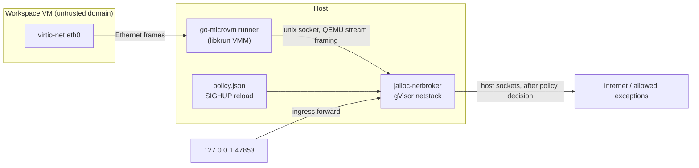

# P2: jailoc network broker

Spec: `vm-acceptance/2` ([vm-acceptance-spec.md](vm-acceptance-spec.md)). Decision recorded in the spec: network policy comes from a jailoc-owned broker in front of the candidate's single guest NIC. This page describes the prototype broker and its acceptance run on macOS with go-microvm.

## Result

With `jailoc-netbroker` as the only network path of a go-microvm guest, every deny check passes in all four contexts, nothing reaches a host or LAN sentinel, and the broker fails closed on invalid policy, broker crash, dead broker at boot, and cached start.

| Area | Result |
|---|---|
| Public egress (TLS, DNS UDP/TCP, QUIC) | PASS, all contexts |
| Host addresses (IPv4 and IPv6), gateway, metadata, private ranges, private resolvers, rebinding | PASS, all contexts; 0 deny-expected sentinel hits |
| IPv6 | broker speaks IPv4 only; `N-V6-DISABLED-*` and `I-V6` PASS |
| Single NIC, routes, vsock | PASS |
| Ingress | PASS: only `127.0.0.1:47853`, owned by the broker; the VMM runner has no TCP/UDP listener |
| Invalid policy reload (SIGHUP) | fail-closed: `deny_all` until a valid reload; no leak |
| Broker SIGKILL + restart | fail-closed: libkrun does not reconnect, guest stays offline until VM restart |
| Boot against a dead broker (stale socket) | no network path; `microvm.Run` returns without error |
| Cached start | first watch tick blocked, public reached 0.5 s later, no deny leak |
| Allowed private exception to the LAN sentinel | not proven: the policy allowed the flow, the host-side dial failed in the test environment |

Verdict (`results/` of run 4): PASS 757, FAIL 16, WARN 42, REVIEW 18, MISSING 0. All 16 FAILs are explained below; none is a deny leak.

## Design

- The VMM attaches the guest NIC to a unix stream socket (`krun_add_net_unixstream`, QEMU framing: 4-byte big-endian length + Ethernet frame). go-microvm exposes this as `microvm.WithNetProvider`; the VMM keeps no network stack of its own.
- `jailoc-netbroker` (`cmd/jailoc-netbroker`, `internal/netbroker`) terminates the frames in a gVisor userspace TCP/IP stack and serves DHCP and DNS on the gateway address (`192.168.127.1`).
- Every guest TCP SYN and UDP flow is decided **before** a host socket opens: fail-closed policy → IPv6 → gateway → guest subnet → host interface addresses (refreshed every 2 s, so interface address changes apply) → hard-deny ranges → public → exception → deny. Denied TCP gets RST, denied UDP gets ICMP unreachable. TCP to an allowed destination is dialled on the host first; a failed dial resets the guest connection.
- DNS from the guest goes to the broker, which forwards to `dns_upstreams` from the policy, or the host's resolvers. DNS answers never change policy decisions.
- Ingress: `-forward 127.0.0.1:HOSTPORT=GUESTPORT`, loopback only.
- Policy file: `{"exceptions":[{"cidr","proto","ports"}],"dns_upstreams":[...]}`, strict JSON. An invalid file at start exits; an invalid file on SIGHUP switches to deny-all.
- Every decision, DNS answer, DHCP lease, policy change and NIC connect is a JSONL event (`results/broker.jsonl`).
- Policy code is independent of `internal/vmprobe`, so the probe judges the broker instead of sharing its logic.

## Run

Harness: `scripts/vm-spike/p2-broker/` (`p2.sh` host driver, `p2-init.sh` guest init, `spike/` go-microvm launcher with a broker `NetProvider`). Guest: `docker:29-dind` rootfs, 4 vCPU, 3 GiB, virtiofs shares, rootful `dockerd` (nftables backend) on a loop-mounted ext4 data disk. Plan: `-ipv6 disabled`, LAN sentinel on a second machine (`LAN`, `LAN_VM` in `p2.sh`) with a policy exception for its address on TCP 47851, host sentinel `sentinel.py`.

Sequence:

1. Start the broker, SIGKILL it (stale socket left), boot the VM for 60 s.
2. Start the broker, boot the VM: DHCP, probes in four contexts, `dockerd`, ingress check, 120 s watch. During the watch: invalid policy via SIGHUP (+10 s), valid policy via SIGHUP (+20 s), SIGKILL the broker (+20 s), restart it (+15 s).
3. Cached start with the broker running and the watch started before DHCP.

Run 1 (`results-run1-csum/`) exposed a broker bug: libkrun negotiates checksum offload, so guest frames carry partial checksums and gVisor silently dropped TCP and DNS. The link endpoint advertises `CapabilityRXChecksumOffload`. Runs 2–3 had no working LAN sentinel. Run 4 is authoritative.

## Results

**Fail-closed timeline** (watch, 1 s ticks): public reached from 16:41:12; blocked at 16:41:56 (invalid reload, broker event `deny_all: true`); reached again at 16:42:15 (valid reload); blocked at 16:42:36 (SIGKILL) and stayed blocked after the broker restart, because libkrun connects the socket once and never reconnects. `L-FAILCLOSED-DENY` and `-SENTINEL` PASS: no deny-expected destination answered on any tick.

**Dead broker at boot**: `microvm.Run` returned after 243 ms with no error and the runner stayed up for 60 s with no network path. A backend must verify the broker before boot and supervise it, because the VMM does not report the missing NIC peer.

**Cached start**: the guest DHCP lease arrives in under 1 s; the boot-time watch saw `public: blocked` on its first tick, then reached, and no deny leak.

**Broker decisions** (run 4): 593 events; flows allowed as `public` 173, denied as `denied-range` 116, `host-address` 104, `fail-closed` 19, `hard-deny` 12, `gateway` 6; allowed by the LAN sentinel exception 8 (dial then failed, see below).

**FAILs**, none of them a leak:

- `N-LAN-TCP` and `D-REBIND-TCP` to the excepted LAN sentinel port (4 contexts each): the policy allowed the flow, but the broker's host-side dial failed with `connect: no route to host` in the test environment, so the broker reset the guest connection. The same port was reachable from other host processes, so the dial failure is specific to how the unsigned broker binary was launched, not to the policy.
- `S-SELFTEST-LAN-*` (4): same host-side dial failure for the unsigned probe binary.
- `S-SELFTEST-HOST-*` (3): one host IPv6 address does not accept inbound connections, so its deny result is not conclusive.
- `F-MNT-INV`: go-microvm's root filesystem is a virtiofs share (P1 finding, not network).

`REVIEW`: `D-RESOLVER-CLASS` (resolver is the broker gateway, as required), `D-REBIND-RESOLVE` (rebinding names resolve; connects are decided by address), `L-FAILCLOSED-PUBLIC` (the outages above), `F-RW-SUID/MKNOD` (host-side checks pass), `S-UNATTRIBUTED` (manual reachability tests against the LAN sentinel).

## Gaps

- **Allowed exceptions end to end**: the allow path is covered by unit tests, but the acceptance run did not complete an allowed private connection. Re-run with the broker launched so its host-side dials to the LAN are permitted, and with packaging that keeps that true for a signed helper.
- **Reconnect**: libkrun does not reconnect the NIC socket, so a broker crash takes the workspace offline until restart. Acceptable as fail-closed; a supervisor should restart broker and VM together.
- **Boot check**: the VMM boots without a NIC peer silently; jailoc has to start and health-check the broker first.
- **IPv6**: the broker has no IPv6 stack; IPv6 is disabled, not enforced.
- **ICMP**: gVisor in promiscuous mode may answer ICMP echo for any destination locally; not verified, and ICMP carries no host traffic.
- **Logs**: the broker's own DHCP broadcast replies appear as denied UDP flows to `255.255.255.255:68`.
- **Linux**: the same broker serves libkrun on Linux (`krun_add_net_unixstream` is platform-independent); a TAP-based VMM (Firecracker, QEMU) would need a TAP or `vhost-user` front end. Not run.
- **Other candidates**: smolvm cannot replace its network stack (it only offers an external allow/deny decider); Lima always adds its own user-mode NIC next to a socket network, which breaks the single-path rule.
